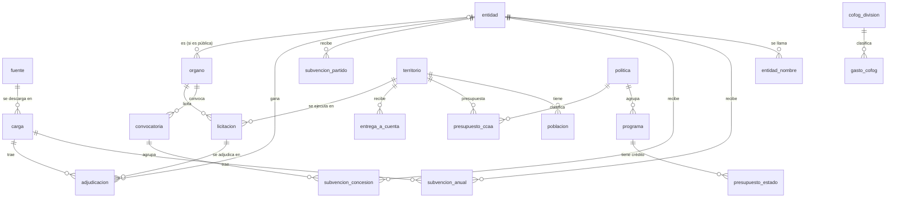

# Modelo de datos de Dinero Público

Propuesta del modelo sobre el que se cargan todas las fuentes en la plataforma de datos (issue #4). Sirve igual para PostgreSQL, para los Parquet de `curated/` y para generar los JSON de `/datos/v1/`, que siguen siendo compatibles.

Las tablas están definidas en [`sql/esquema.sql`](../sql/esquema.sql), y `python -m dinero_datos curar` ya las genera en Parquet a partir de `/datos/v1/`. Respecto a lo de aquí abajo, tienen pequeñas diferencias de nombre y algunas tablas más: `presupuesto_ccaa_economica`, `presupuesto_ccaa_prorroga`, `gasto_cofog_total`, `pib`, `subvencion_partido_organo` y `codigo_lista`.

## Ideas que lo guían

1. **Cuatro capas, cada una se rehace desde la anterior.**
   - `raw`: originales oficiales tal cual. Son privados y llevan versión.
   - `curated`: una tabla por hecho, ya normalizada, en Parquet.
   - `servicio`: PostgreSQL con índices y vistas.
   - `publicación`: JSON v1, API y descargas.

   Nada se edita a mano en una capa intermedia.
2. **El dato oficial, sin retocar.** Se guardan los importes, títulos y nombres tal como los publica la fuente. Lo que se calcula (administración, comunidad, «es valor máximo»…) va en columnas propias y se puede rastrear.
3. **El NIF une las fuentes.** Una entidad (empresa, ayuntamiento, universidad, partido…) es su NIF. Los nombres cambian entre fuentes y años, así que se guardan aparte.
4. **Sin datos personales.** Las personas físicas se disocian al transformar: `nif` vacío y nombre «Persona física (nombre no publicado)». Cuentan en los totales y en ningún sitio más. Solo `raw` conserva el original, y no se publica.
5. **Euros y fechas sin ambigüedad.** Los importes van en euros (`numeric(16,2)`), no en millones; la web convierte. Cada importe lleva su base: sin IVA, ayuda equivalente, crédito inicial… Los años son los de la fuente, y cuando hay prórroga se guarda el año en que rige.
6. **Trazabilidad.** Cada fila de un hecho apunta a la `carga` que la trajo: fuente, fecha, hash del original y versión de la herramienta.

## Diagrama

## Catálogos (dimensiones)

| Tabla | Clave | Columnas principales | De dónde sale |
|---|---|---|---|
| `fuente` | `id` (`bdns`, `placsp`, `sepg`…) | organismo, nombre, url, aviso legal, periodicidad, ámbito («incluye / no incluye») | Fijo, en el código |
| `carga` | `id` | fuente, inicio, fin, estado, hash del original, filas, versión de la herramienta, error | Cada ejecución de un CronJob |
| `entidad` | `nif` | tipo de NIF (primera letra: A, B, P, Q, S, U…), nombre de referencia, es_publica | Unión de los NIF de todas las fuentes |
| `entidad_nombre` | `nif`, `nombre`, `fuente` | primera y última vez visto | Cada fuente |
| `organo` | `id` (hash de nombre, NIF y DIR3) | nombre, NIF, DIR3, administración (Estado, comunidades autónomas, entidades locales, universidades, otras), comunidad, `nif_entidad` | Órganos de contratación (Plataforma de Contratación) y órganos concedentes (BDNS) |
| `territorio` | `codigo` | nivel (España, comunidad, provincia, municipio), nombre corto, código INE, NUTS, régimen foral | INE y códigos de las fuentes. Hoy hay tres codificaciones: SGCIEF «01»…, NUTS «ES61» y nombres del INE; la tabla las une |
| `politica`, `programa` | código | nombre, área de gasto | SEPG y SGCIEF (misma clasificación funcional) |
| `capitulo`, `economica` | código | nombre | Clasificación económica |
| `cpv` | código de 8 cifras | descripción, división | Vocabulario común de contratos de la UE |
| `cofog_division` | código | nombre | IGAE y Naciones Unidas |
| Listas de códigos | código | nombre | Tipo de contrato, procedimiento, sistema de contratación, instrumento de ayuda, finalidad… |

## Hechos

### Subvenciones (BDNS)

| Tabla | Grano (una fila por…) | Medidas y atributos |
|---|---|---|
| `subvencion_anual` | año × beneficiario | `nif` (vacío si es persona física), nombre publicado, `importe_equivalente`, puesto |
| `convocatoria` | convocatoria | código BDNS, título oficial, finalidad, `organo_id`, procedimiento, MRR, detalle consultado (sí o no) |
| `subvencion_concesion` | año × beneficiario × convocatoria × instrumento | importe, número de concesiones. Hoy solo para los 1.000 mayores de cada año |
| `subvencion_partido` | año × NIF | nombre, nivel de la administración que concede, importe, concesiones |

### Contratos (Plataforma de Contratación, y más adelante plataformas autonómicas, contratos menores y TED)

| Tabla | Grano | Medidas y atributos |
|---|---|---|
| `licitacion` | licitación (id de la Plataforma) | expediente, `organo_id`, objeto, tipo, procedimiento, **sistema** (contrato, acuerdo marco, SDA, basado en…), CPV, lugar de ejecución (`territorio`), fondos UE, enlace, última actualización, anulada |
| `adjudicacion` | licitación × lote × adjudicatario | `nif` (vacío si es persona física), nombre publicado, fecha, importe sin IVA, importe con IVA, ofertas recibidas, pyme, **`es_valor_maximo`** (acuerdo marco o SDA: no suma), **`importe_compartido`** (el mismo importe ya contado para otro adjudicatario del lote) |

Al cambiar de fuente o de plataforma solo cambia `licitacion.fuente`. La deduplicación entre la Plataforma, las plataformas autonómicas y TED se hace por expediente y órgano.

### Presupuestos y gasto

| Tabla | Grano | Medidas y atributos |
|---|---|---|
| `presupuesto_estado` | ejercicio × programa | crédito inicial consolidado; columna de la SEPG, año en que rige, si es prórroga y de qué año |
| `presupuesto_ccaa` | año × comunidad × política × capítulo (y económica) | crédito inicial; prorrogado (deducido) |
| `entrega_a_cuenta` | año × comunidad × concepto | importe |
| `gasto_cofog` | año × subsector × territorio × división | gasto ejecutado (contabilidad nacional) |
| `ejecucion_estado` | año × mes × partida | importe acumulado; PIB |
| `poblacion` | año × territorio | habitantes a 1 de enero |

### Fuentes previstas (issue #3)

Siguen el mismo patrón: un hecho con su grano y sus claves hacia los catálogos.
- `presupuesto_local` y `liquidacion_local`: año × municipio × política × capítulo.
- `ejecucion_ccaa`: año × mes × comunidad × capítulo.
- `ayuda_ue`: Kohesio y FEGA; año × NIF × programa.
- `recaudacion`: año × mes × impuesto × comunidad.
- `pension`: año × provincia × tipo.
- `deuda`: año × administración.

## Vistas: lo que usan la web y la API

| Vista | Para qué |
|---|---|
| `entidad_resumen` | Por NIF y año: subvenciones recibidas, contratos ganados (sin valor máximo) y, si es un órgano, contratos adjudicados. Es la ficha «todo lo de este NIF» y el cruce que hoy hace el navegador. |
| `contratos_resumen` | Lo que hoy es `contratos.json`: totales por año, tipo, procedimiento, sistema, administración, comunidad, mes y mayores adjudicatarios y órganos. |
| `subvenciones_resumen` | Lo que hoy es `subvenciones.json`. |
| `por_habitante` | Cualquier importe por territorio y año dividido por la población. Usa la del último año disponible si falta y lo indica. |

Las vistas de resumen generan los JSON de `/datos/v1/`. El formato publicado no cambia, de modo que la web actual sigue funcionando mientras se pasa a la API.

## Comprobaciones

Las de `informe.json` pasan a ser consultas sobre el modelo, con el mismo resultado publicado:
- las sumas por política, capítulo, tipo… dan el total;
- no hay personas físicas con nombre;
- cada adjudicación apunta a una licitación y a un órgano existentes;
- ningún NIF tiene dos tipos;
- en cada fuente están todos los años y territorios esperados.

## Del formato actual al modelo

| Hoy (`/datos/v1/`) | En el modelo |
|---|---|
| `subvenciones-AAAA.json` `[nif, nombre, euros]` | `subvencion_anual` |
| `subvenciones-motivos-AAAA.json` | `subvencion_concesion` + `convocatoria` + `organo` |
| `contratos-AAAA-MM.json` (filas con índices a `organos` y `adjudicatarios`) | `licitacion` + `adjudicacion` + `organo` + `entidad` |
| `contratos-adjudicatarios-AAAA.json` | vista `entidad_resumen` |
| `pge.json`, `ccaa.json`, `entregas.json`, `cofog.json`, `estado.json`, `poblacion.json` | sus tablas de hechos + `territorio`, `politica`, `programa` |
